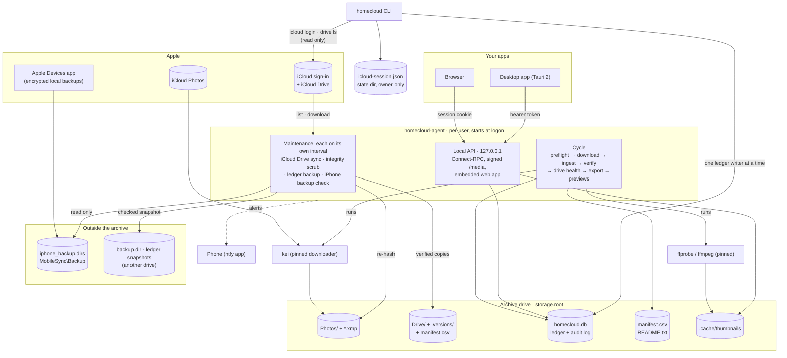
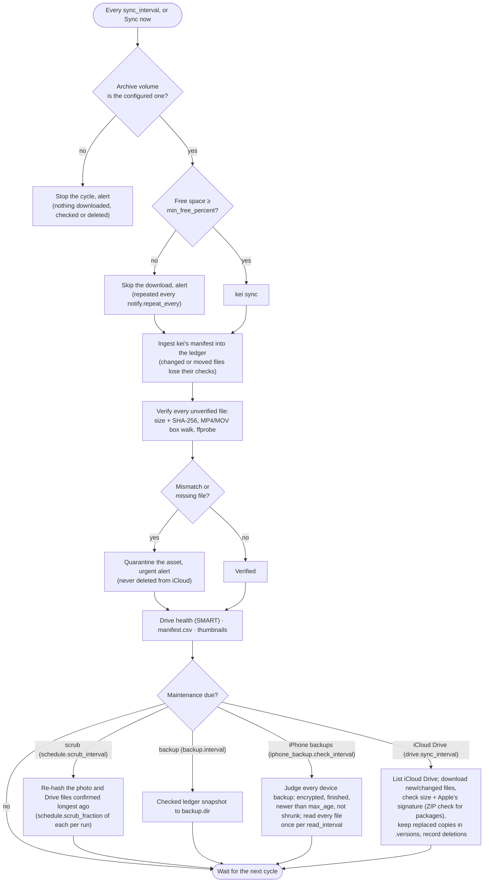

# homecloud

Personal, private service that makes a local drive the verified home of my iCloud data
(Photos, Drive, iPhone backups) and, once P3 is built, keeps iCloud itself down to the most
recent 30 days.

- Design, decisions, sources and spike findings: [`docs/design.md`](docs/design.md)
- Status: **P1 done, M1–M4 live, P2 built** (its iPhone monitor waits for the first encrypted
  backup): iCloud Photos archive with verification, scheduled integrity re-checks, ledger backups,
  drive health, library browser, local API, web and desktop apps, a monitor of the local iPhone
  backups, homecloud's own iCloud sign-in and the iCloud Drive archive (`Drive/`, never deletes)
  with its own Overview card, Activity tab and events. No deletion capability exists yet (P3).

## How it works

`homecloud-agent` runs at logon and owns everything. Every `schedule.sync_interval` it runs one
cycle; after a cycle it runs whichever maintenance job is due. Every step is recorded in a SQLite
ledger (`homecloud.db`) with an append-only audit log, and every problem sends an
[ntfy](https://ntfy.sh) alert.



A cycle never touches a drive it cannot confirm, and quarantine is the only reaction to a file
that fails a check:



The agent serves a local API ([Connect](https://connectrpc.com), contract in
`proto/homecloud/agent/v1`) on `web.listen` (always `127.0.0.1`). Same-user clients read the
bearer token from the owner-only discovery file `agent.json` in the per-user state directory
(`%LOCALAPPDATA%\homecloud` on Windows, `$XDG_STATE_HOME/homecloud` on Linux); the token changes
every time the agent starts. Browsers sign in with a one-time code from `homecloud open`.

## Requirements

- Windows 11 amd64, or Linux (amd64/arm64) with glibc ≥ 2.39 (Ubuntu 24.04, Debian 13) and
  Linux ≥ 5.8
- Go 1.27.1; Node.js 24 with pnpm (version pinned in `ui/package.json`)
- [kei](https://github.com/rhoopr/kei) 0.24.1 and FFmpeg 9.0.2 (`ffprobe` and `ffmpeg`), pinned
  in the config and checked by `homecloud doctor`
- The desktop app additionally needs Rust (pinned in `desktop/src-tauri/rust-toolchain.toml`)
  and, on Linux, the [Tauri prerequisites](https://v2.tauri.app/start/prerequisites/)

## Build and install

```powershell
# The agent embeds the web app (ui/), so build that first.
pnpm --dir ui install --frozen-lockfile
pnpm --dir ui build

$dest = "$env:LOCALAPPDATA\Programs\homecloud"
go build -trimpath -o "$dest\homecloud.exe" ./cmd/homecloud
go build -trimpath -ldflags=-H=windowsgui -o "$dest\homecloud-agent.exe" ./cmd/homecloud-agent
& "$dest\homecloud.exe" doctor
& "$dest\homecloud.exe" install     # logon task with --config <this config>, started now
```

On Linux build both commands without `-ldflags`; `homecloud install` writes a systemd `--user`
unit (`loginctl enable-linger` keeps it running on a headless host).

### Desktop app

The desktop app (Tauri 2, `desktop/`) shows the same web app in a native window and talks to
the running agent with the token from its discovery file; the agent stays installed and running
on its own. The app and the agent are built from the same commit: install both together.

```powershell
pnpm --dir ui build                              # the installer packages ui/dist as it is
pnpm --dir desktop install --frozen-lockfile
pnpm --dir desktop tauri build --bundles nsis   # per-user installer, no admin rights
# Installs to %LOCALAPPDATA%\homecloud Desktop (apart from the agent's state in %LOCALAPPDATA%\homecloud).
& "desktop\src-tauri\target\release\bundle\nsis\homecloud Desktop_0.1.0_x64-setup.exe"
```

## Configuration

`config.toml` is found in this order: `--config`, then `HOMECLOUD_CONFIG`, then
`%APPDATA%\homecloud\config.toml` (Linux: `$XDG_CONFIG_HOME/homecloud/config.toml`). The CLI and
the agent resolve it the same way, and `homecloud install` registers the agent with the exact
path it validated. Every key is required; the schema is `internal/config`.

| Section | Keys |
|---|---|
| `[storage]` | `root`, `volume_id` (the archive volume's identity), `min_free_percent` |
| `[icloud]` | `apple_id`, `include_hidden`, `request_timeout` (one call of homecloud's own iCloud client, 10s–10m) |
| `[kei]` | `binary`, `version`, `config` (generated by the agent; don't edit by hand) |
| `[ffmpeg]` | `ffprobe`, `ffmpeg`, `version`, `probe_timeout` (one video check, 30s–1h), `renderers` (thumbnails rendered at once, 1–16), `render_timeout` (one thumbnail, 10s–30m) |
| `[verify]` | `workers` (files checked at once by syncs and integrity checks, 1–32) |
| `[web]` | `listen` (`127.0.0.1:<port>`), `session_ttl` (how long a browser stays signed in, 1h–720h) |
| `[notify]` | `server`, `topic`, `repeat_every` (how often an alert about a lasting problem repeats, ≥ 1h), `timeout` (5s–2m) |
| `[schedule]` | `sync_interval`, `scrub_interval`, `scrub_fraction` |
| `[backup]` | `dir` (must be on another drive than `storage.root`), `interval`, `keep` |
| `[drive]` | `sync_interval` (≥ 15m), `workers` (parallel downloads, 1–16), `stall_timeout` (a download receiving nothing this long is retried next sync, 30s–10m) |
| `[iphone_backup]` | `dirs` (absolute paths, written out: Apple Devices uses `C:\Users\<you>\Apple\MobileSync\Backup`, desktop iTunes `C:\Users\<you>\AppData\Roaming\Apple Computer\MobileSync\Backup`), `max_age`, `check_interval` (≤ `max_age`), `read_interval` (how often every backup file is read in full, ≥ `check_interval`), `stalled_after` (a backup still running this long counts as unfinished), `max_shrink_percent` |
| `[logs]` | `max_size_mb`, `max_backups`: rotation of the agent's log files under `<storage.root>\logs` on Windows (Linux logs to journald) |

## Operating

| Command | Purpose |
|---|---|
| `homecloud doctor` | Read-only checks: archive root and volume identity, free space, backup dir on another drive, generated kei config, pinned tool versions, iPhone backup folders |
| `homecloud open` | Open the web app in the browser, signed in through a one-time code |
| `homecloud status` | Asset counts by state |
| `homecloud quarantine list` | Files that failed a check, with the reason |
| `homecloud quarantine release --library L --asset A --reason R` | Lift a quarantine (audited); the asset's files are checked again |
| `homecloud verify` | Ingest kei's manifest and run all outstanding verification, without iCloud |
| `homecloud notify-test` | Send a test push notification |
| `homecloud install` / `uninstall` | Register / remove the logon task (Windows) or systemd user unit (Linux) |
| `homecloud icloud login` | Sign in to iCloud in a terminal (password, then a code from a trusted device or `sms N`); the password is used once and never stored |
| `homecloud icloud status` | Check that the saved iCloud session still works |
| `homecloud drive ls [--folder ID]` | List an iCloud Drive folder (read only) |

`verify` and `quarantine release` write the ledger, which the running agent owns: while it runs
they refuse, and the same actions are in the app (Sync now, Quarantine → Release).

When kei's Apple session expires the agent alerts every `notify.repeat_every`; re-authenticate with
`kei login --config <kei config>` and approve the code on a trusted device.

**Restore the ledger** from a snapshot: stop the agent, delete `homecloud.db-wal` and
`homecloud.db-shm` next to `<storage.root>\homecloud.db` if they exist, copy the newest
`homecloud-*.db` from `backup.dir` over `homecloud.db`, and start the agent again.

**Logs:** Windows: `<storage.root>\logs\homecloud-agent.log` and `kei.log` (rotated); failures
before the config is loaded go to `%LOCALAPPDATA%\homecloud\agent-startup.log`. Linux: the
journal (`journalctl --user -u homecloud-agent`).

## Development

```powershell
go vet ./...           # needs ui/dist (see Build)
go test ./...          # CI also runs -race on Windows and Linux
golangci-lint run      # and with GOOS=linux
pnpm --dir ui lint; pnpm --dir ui typecheck; pnpm --dir ui test
```

- **API contract:** edit `proto/homecloud/agent/v1/agent.proto`, then `go tool buf lint` and
  `go tool buf generate` (needs `pnpm install` in `ui/`, which pins `protoc-gen-es`). Generated
  code under `gen/` and `ui/src/gen/` is committed; CI fails if it is stale or breaks the API.
- **Web app:** `pnpm --dir ui dev` serves it with hot reload and proxies the API and `/media` to
  the running agent, found through its discovery file; sign in with the code printed by
  `homecloud open`. `pnpm --dir desktop tauri dev` uses the same dev server and proxy.
- **Linux tests on Windows:** Docker's container file system has no volume identity, so give
  `/tmp` a named volume:
  `docker run --rm -v ${PWD}:/src:ro -v hc-tmp:/tmp -w /src -e GOFLAGS=-buildvcs=false golang:1.27 sh -c "mkdir /work && tar -C /src --exclude=./desktop/src-tauri/target --exclude=node_modules --exclude=./.git -cf - . | tar -C /work -xf - && cd /work && go test -race ./..."`
  (`ui/dist` must exist).
- **CI** runs only the jobs whose inputs changed (Go, web, contract, desktop); a change to the
  workflow runs everything.
- **Keep this README and its diagrams current** with every change to commands, configuration,
  the cycle, or the components they show; `docs/design.md` holds the reasons.
