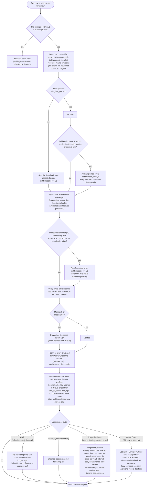
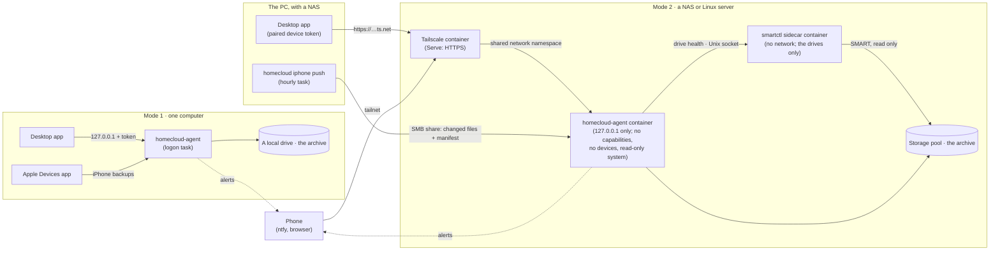

# homecloud

Personal, private service that makes a local drive the verified home of my iCloud data
(Photos, Drive, iPhone backups) and, once P3 is built, keeps iCloud itself down to the most
recent 30 days.

- How the parts fit together and why this stack: [Architecture and stack](#architecture-and-stack);
  decisions, sources and spike findings: [`docs/design.md`](docs/design.md)
- Status: **P1 done, M1–M4 live, P2 built** (its iPhone monitor waits for the first encrypted
  backup): iCloud Photos archive with verification, scheduled integrity re-checks, ledger backups,
  drive health, library browser, local API, web and desktop apps, a monitor of the local iPhone
  backups with verified copies of them in the archive, homecloud's own iCloud sign-in and the iCloud Drive archive (`Drive/`, never deletes)
  with its own Overview card, Activity tab and events. No deletion capability exists yet (P3).

## How it works

`homecloud-agent` runs at logon and owns everything. Every `schedule.sync_interval` it runs one
cycle; after a cycle it runs whichever maintenance job is due. Every step is recorded in a SQLite
ledger (`homecloud.db`) with an append-only audit log, and every problem sends an
[ntfy](https://ntfy.sh) alert.

```mermaid
flowchart TB
    subgraph apple["Apple"]
        icloud[("iCloud Photos")]
        drivesvc[("iCloud sign-in<br/>+ iCloud Drive")]
        devices["Apple Devices app<br/>(encrypted local backups)"]
    end
    subgraph apps["Your apps"]
        browser["Browser"]
        desktop["Desktop app (Tauri 2)"]
    end
    cli["homecloud CLI"]

    subgraph agent["homecloud-agent · per-user at logon, or a container on a NAS"]
        api["Local API · 127.0.0.1<br/>Connect-RPC, signed /media,<br/>embedded web app"]
        cycle["Cycle<br/>preflight → repairs → download → ingest<br/>→ verify → drive health → export → previews"]
        maint["Maintenance, each on its own interval<br/>iCloud Drive sync · integrity scrub<br/>· ledger backup · iPhone backup check"]
    end

    kei["kei (pinned downloader)"]
    ffmpeg["ffprobe / ffmpeg (pinned)"]
    smart["Drive health: NVMe log (Windows) ·<br/>udisks, pinned smartctl or the<br/>container's smartctl sidecar (Linux)"]

    subgraph archive["Archive storage · storage.root<br/>(one drive, or a RAID of several)"]
        photos[("Photos/ + *.xmp")]
        drivedir[("Drive/ + .versions/<br/>+ manifest.csv")]
        ledger[("homecloud.db<br/>ledger + audit log")]
        exports[("manifest.csv · README.txt<br/>safe-to-delete.csv")]
        thumbs[(".cache/thumbnails")]
        iphonecopies[("iPhone backups/<br/>verified copies")]
        damaged[("Damaged/<br/>files a repair replaced")]
    end

    subgraph outside["Outside the archive"]
        iphone[("iphone_backup.dirs<br/>MobileSync\Backup")]
        incoming[("iphone_backup.incoming<br/>(a NAS shared folder)")]
        backups[("backup.dir · ledger snapshots<br/>(another drive)")]
        logs[("Logs · state dir (Windows),<br/>journald or docker logs (Linux)")]
    end
    phone["Phone (ntfy app)"]

    browser -- "session cookie" --> api
    desktop -- "bearer token" --> api
    icloud --> kei
    cycle -- "runs" --> kei
    cycle -- "runs" --> ffmpeg
    cycle -- "every drive + md array<br/>under the archive" --> smart
    kei --> photos
    cycle -- "repair: move the damaged file aside" --> damaged
    cycle --> ledger
    cycle --> exports
    ffmpeg --> thumbs
    api --> ledger
    api --> thumbs
    maint -- "re-hash" --> photos
    drivesvc -- "list · download" --> maint
    maint -- "verified copies" --> drivedir
    maint -- "checked snapshot" --> backups
    devices --> iphone
    maint -- "read only" --> iphone
    maint -- "verified, deduplicated copies" --> iphonecopies
    push["homecloud iphone push<br/>(the computer that backs up)"] -- "signed: changed files + manifest" --> incoming
    incoming -- "signature, files and plists checked, taken in" --> maint
    cli -- "one ledger writer at a time" --> ledger
    cli -- "icloud login · drive ls<br/>(read only)" --> drivesvc
    cli --> session[("icloud-session.json<br/>state dir, owner only")]
    agent -. "alerts" .-> phone
    agent -- "JSON lines, one run each" --> logs
```



A cycle never touches a drive it cannot confirm, and quarantine is the only reaction to a file
that fails a check. You then release it (the check was wrong) or repair it (download it again):



The agent serves a local API ([Connect](https://connectrpc.com), contract in
`proto/homecloud/agent/v3`) on `web.listen` (always `127.0.0.1`). Same-user clients read the
bearer token from the owner-only discovery file `agent.json` in the per-user state directory
(`%LOCALAPPDATA%\homecloud` on Windows, `$XDG_STATE_HOME/homecloud` on Linux); the token changes
every time the agent starts. Browsers sign in with a one-time code from `homecloud open`, at
`http://homecloud.localhost:<port>` on this computer, so the session cookie stays the app's own.

## Architecture and stack

### The parts

| Part | What it is | Where it runs |
|---|---|---|
| `homecloud-agent` | The service. It alone runs kei, verifies files, schedules every job, writes the ledger, sends alerts, and serves the API and the web app. | At logon for the owner (Windows Task Scheduler, systemd `--user`), or a container on a NAS |
| `homecloud` | The command-line tool: setup (`archive init`, `install`), sign-in (`icloud login`), checks (`doctor`, `status`), and `iphone push`. It shares the agent's packages and takes the same lock before writing the ledger. | The same computer, or `docker compose exec` on the NAS |
| Web app (`ui/`) | The whole interface: Overview, Library, Activity, Quarantine, Safe to delete, Settings. Built once and embedded in the agent's binary. | Any browser, served by the agent |
| Desktop app (`desktop/`) | A native window around the same web app. It talks to this PC's agent or to a paired homecloud on a NAS and keeps its credentials in the OS credential store. | Windows, Linux |
| kei, FFmpeg, smartctl | Pinned external tools: kei downloads iCloud Photos, `ffprobe` checks videos and `ffmpeg` renders thumbnails, `smartctl` reads drive health in the container. | Next to the agent |
| The archive | Plain files you can use without homecloud (`Photos/`, `Drive/`, `iPhone backups/`, and `Damaged/` for the files repairs replaced) plus `homecloud.db`, the ledger of what was downloaded, when and how it was verified, `manifest.csv`, and `safe-to-delete.csv`. | One folder: `storage.root` |



Both modes run the same agent; only where it runs and how you reach it change. On a NAS the
agent still listens on loopback only: the Tailscale container shares its network and publishes
it to your own devices at `https://<name>.<tailnet>.ts.net` with a real certificate, and nowhere
else.

### Why this stack

| Layer | Choice | Why | Instead of |
|---|---|---|---|
| Agent and CLI | **Go** | One self-contained binary per platform, built without C (`CGO_ENABLED=0`), so Windows and Linux on amd64 and arm64 all come from one machine and the NAS image needs no runtime. The standard library covers most of what the agent needs (HTTP server, SHA-256, XML, files confined with `os.Root`, the web app embedded with `go:embed`); the few formats it lacks, binary plists and DNG previews, are small parsers of our own. Goroutines run verification and Drive downloads in parallel within set limits. | A runtime to install on every host (Node, Python, .NET) |
| Ledger | **SQLite** through `modernc.org/sqlite` (pure Go): WAL, `synchronous=FULL`, STRICT tables, an append-only event log enforced by triggers | One transactional file next to the archive, with no server to run. Scheduled snapshots, checked with `integrity_check` before they count, go to another drive. On a NAS the ledger stays on the NAS's own disk: SQLite's WAL does not work over a network share. | A database server for a single writer; plain JSON files without transactions |
| Photos download | **kei** (pinned, driven through its CLI and JSON manifest) | Maintained, checksum-verified downloads, and a manifest homecloud can verify against; deleting from iCloud is outside its scope. | icloudpd: its move mode deletes assets whose download failed (#1312), it truncates videos over 1 GB (#1311), and it is looking for a maintainer |
| iCloud Drive | **homecloud's own client** (`internal/icloud`, `internal/drive`) | No maintained tool archives Drive without deleting: rclone's backend deletes valid Pages/Numbers/Keynote downloads (#8404) and exposes no hashes. Apple's download signature lets every file be checked end to end. | rclone, pyicloud |
| API | **Connect** with a Protobuf contract (Buf) | One typed contract generates both the Go server and the TypeScript client. It runs over plain HTTP on loopback, server streaming included (the live Overview), and a browser calls it directly, without a gRPC-Web proxy. CI rejects an incompatible change to an API version (`buf breaking`); a breaking change gets a new version (`v3` now). | REST with hand-written types; gRPC, which needs a proxy for browsers |
| Interface | **React 19 + Fluent UI v9**, TypeScript, Vite | Fluent is Microsoft's design system, so the app looks native on Windows 11. One app serves the browser, the desktop window and the NAS. | Separate native interfaces per platform |
| Desktop | **Tauri 2** (a Rust shell) | Uses the system's web view (WebView2, WebKitGTK), so the installer is about 2.5 MB. The page can call only seven small commands (where its agent is and how to sign in to it, pairing with a NAS, starting the agent, showing a file in its folder), and its content security policy lets it reach only the local agent and `*.ts.net`. It runs on Windows and Linux. | Electron (ships its own Chromium); Wails v3 (beta); WinUI 3 (Windows only); MAUI (no Linux); Flutter and Avalonia (another UI stack) |
| Remote access | **Tailscale Serve** | Your devices only, with real HTTPS, and nothing opened on the LAN or the internet; the agent never leaves loopback. | Listening on the LAN (cleartext, or a private CA on every device); Cloudflare Tunnel (puts the app on the internet) |
| Alerts | **ntfy** | Push notifications to the phone with no account; a long random topic is the secret, and alerts never name files or devices. | Email, an account-based push service |
| Container | Debian 13 image for amd64 and arm64, pinned by digest | Every input is pinned: kei by its release checksums, FFmpeg by its signed release tarball, smartmontools by its Debian package. It runs as your NAS user; only `smartctl` gets the rights to query drives. | A general-purpose image with tools fetched at run time |

### Principles the code follows

- **Fail closed.** A missing drive, a hash mismatch or a health problem stops the step and alerts.
  Nothing is ever taken as fine by default.
- **Verify everything, keep everything.** Every downloaded file is checked against what iCloud
  says it is (SHA-256, video structure, `ffprobe`) and re-checked on a schedule. A file that
  fails is quarantined and kept; repairing it downloads it again and moves the damaged file to
  `Damaged/`. Nothing is deleted, from iCloud or from the archive, except
  homecloud's own derived data: the thumbnail cache, rotated logs, old ledger snapshots, and
  iPhone backup copies beyond `keep`.
- **One writer.** Only one process writes the ledger at a time (the agent, or the CLI while the
  agent is stopped).
- **No lock-in.** The archive is ordinary files in dated folders, with XMP sidecars,
  `manifest.csv` and `README.txt`. iPhone backup copies can be restored by copying them back.
- **The operating system stays in one place.** OS-specific code lives only in `internal/platform`
  (`*_windows.go`, `*_linux.go`); everything else is shared.
- **Pinned, verified dependencies.** Tools and libraries are pinned and their versions checked
  (`homecloud doctor`). Third-party libraries are used only where no official one exists and
  writing our own would be worse ([docs/design.md §9](docs/design.md#9-dependencies-verified-2026-10-07)).

### Repository layout

| Path | What is there |
|---|---|
| `cmd/homecloud`, `cmd/homecloud-agent` | The CLI and the agent (built windowless on Windows) |
| `internal/app` | The agent: the cycle, maintenance jobs, live status |
| `internal/ledger` | The SQLite ledger and its migrations |
| `internal/kei`, `internal/verify` | Running kei; the verification tiers |
| `internal/icloud`, `internal/drive` | homecloud's own iCloud sign-in and the iCloud Drive archive |
| `internal/iphonebackup`, `internal/iphonecopy` | Judging iPhone backups; their verified copies and pushes |
| `internal/health`, `internal/smartctl` | Drive and RAID health |
| `internal/api`, `internal/web`, `internal/auth` | The Connect API, the HTTP server (Host, Origin, CORS checks), tokens and sign-in codes |
| `internal/platform` | Everything specific to Windows or Linux |
| `proto/`, `gen/`, `ui/src/gen/` | The API contract and the code generated from it |
| `ui/`, `desktop/` | The web app and the Tauri desktop shell |
| `Dockerfile`, `deploy/` | The container image and the NAS compose setup |
| `docs/design.md` | Decisions, sources and findings behind all of the above |

## Requirements

- Windows 11 amd64, or Linux (amd64/arm64) with glibc ≥ 2.39 (Ubuntu 24.04, Debian 13) and
  Linux ≥ 5.8
- Go 1.27.3; Node.js 24 with pnpm (version pinned in `ui/package.json`)
- [kei](https://github.com/rhoopr/kei) 0.26.0 and FFmpeg 9.0.2 (`ffprobe` and `ffmpeg`), pinned
  in the config and checked by `homecloud doctor`. FFmpeg needs libwebp (thumbnails) and libjxl
  (JPEG XL previews in DNG 1.7 files); on Windows the Gyan `full_build` has both
- The desktop app additionally needs Rust (pinned in `desktop/src-tauri/rust-toolchain.toml`)
  and, on Linux, the [Tauri prerequisites](https://v2.tauri.app/start/prerequisites/)

## Build and install

```powershell
# The agent embeds the web app (ui/), so build that first.
pnpm --dir ui install --frozen-lockfile
pnpm --dir ui build

$dest = "$env:LOCALAPPDATA\Programs\homecloud"
go build -trimpath -o "$dest\homecloud.exe" ./cmd/homecloud
go build -trimpath -ldflags=-H=windowsgui -o "$dest\homecloud-agent.exe" ./cmd/homecloud-agent
& "$dest\homecloud.exe" doctor
& "$dest\homecloud.exe" install     # logon task with --config <this config>, started now
```

On Linux build both commands without `-ldflags`; `homecloud install` writes a systemd `--user`
unit (`loginctl enable-linger` keeps it running on a headless host).

### Container (NAS or any Linux host)

`Dockerfile` builds one image for `linux/amd64` and `linux/arm64` with the agent, the CLI, kei
and FFmpeg, every input pinned (base images by digest, kei by its release checksums, FFmpeg 9.0.2
from its signed release tarball, with libwebp, libjxl and zlib only). The agent is the entrypoint.

```sh
docker buildx build --platform linux/amd64,linux/arm64 --build-arg VERSION=$(git rev-parse --short HEAD) -t homecloud .
docker run --rm -v /srv/archive:/archive --entrypoint homecloud homecloud archive init --root /archive   # once; prints storage.archive_id
```

| Mount | Holds | Config |
|---|---|---|
| `/archive` | the archive | `storage.root = '/archive'`, `kei.config = '/archive/kei/config.toml'` |
| `/config` (read-only) | `config.toml` | found through `HOMECLOUD_CONFIG` |
| `/state` | the agent's and kei's state, including both iCloud sessions: keep it private | `XDG_STATE_HOME`, `KEI_DATA_DIR` |
| `/backups` | ledger snapshots, **on another drive than `/archive`** (doctor checks) | `backup.dir = '/backups'` |
| `/iphone` | backups pushed from the computer Apple's Devices app backs up to (`homecloud iphone push`) | `iphone_backup.incoming = '/iphone'`, `dirs = []`, `keep` ≥ 1 |

Tools: `kei.binary = '/opt/kei/kei'`, `ffmpeg.ffmpeg = '/opt/ffmpeg/bin/ffmpeg'`,
`ffmpeg.ffprobe = '/opt/ffmpeg/bin/ffprobe'`. Run it as the user that owns the folders
(`--user UID:GID`; the image never runs as root by default): the agent makes `/archive` that
user's alone (mode 0700) when it starts, and `/backups` and kei's folder when it writes to
them, so browse the archive as that user. The agent needs no capability, no device and no
writable system: run it with `--cap-drop ALL --security-opt no-new-privileges:true --read-only
--tmpfs /tmp`, as `deploy/compose.yaml` does. Logs go to the container's output (`docker logs`).

**Drive health in the container:** set `drive_health.source = "smartctl"` and
`[smartctl] binary = '/usr/sbin/smartctl'`, `version = "7.5"`,
`socket = '/run/homecloud-smartctl/smartctl.sock'`. The agent follows the archive's file system
down through LVM and md RAID to every drive under it, plus each md array's state, and asks the
**smartctl sidecar** for each drive's health: a second container from the same image running
`homecloud smartctl serve`, the only one with the drives and the capabilities that query them
(smartmontools 7.5 from Debian's backports). It has no network and answers on a Unix socket in a
volume both containers share; the agent, which parses media downloaded from iCloud, keeps
neither. Pass every drive under the archive to the sidecar read-only by its stable name
(`/dev/disk/by-id/ata-…:/dev/disk/by-id/ata-…:r`) and allow it `SYS_RAWIO`, `SYS_ADMIN` and
`DAC_OVERRIDE`, which only the image's `smartctl` carries (Docker gives a non-root user none).
`deploy/compose.yaml` sets both containers up. `homecloud doctor` lists the drives and arrays it
found and names a drive it could not read.

**On a NAS, with the app on your other devices:** `deploy/compose.yaml` runs the image next to
a [Tailscale](https://tailscale.com) container that shares its network: the agent still listens
only on `127.0.0.1`, and Tailscale Serve (`deploy/serve.json`) publishes it to your tailnet,
and nowhere else, at `https://<TS_HOSTNAME>.<tailnet>.ts.net` with a real certificate. Enable
MagicDNS and HTTPS certificates for the tailnet, copy `deploy/homecloud.env.example` to
`deploy/.env` and fill it in (including the archive's drives, `HOMECLOUD_DRIVE_1`/`_2`), set
`web.public_origin` to that address and `smartctl.socket` as above, then
`docker compose up -d` and sign in with the link `docker compose exec homecloud homecloud open
--print` prints.

**Tailnet policy (before the first start):** the node joins as `tag:homecloud`
(`TS_EXTRA_ARGS` in the compose file), and your devices may reach port 443 of it and nothing
else. In userspace networking Tailscale hands a connection to any port of the node to
`127.0.0.1` at that port, so without this your devices could also reach the agent's
plain-HTTP port (where requests still need a sign-in). In the admin console's policy file, let
the tailnet's admins own the tag, grant that one port, and add tests, which Tailscale runs on
every change to the policy and refuses the change when one fails (`<you>` is your Tailscale
login, `8790` the port of `web.listen`):

```json
"tagOwners": {
  "tag:homecloud": ["autogroup:admin"]
},
"grants": [
  { "src": ["autogroup:member"], "dst": ["tag:homecloud"], "ip": ["tcp:443"] }
],
"tests": [
  { "src": "<you>", "proto": "tcp", "accept": ["tag:homecloud:443"], "deny": ["tag:homecloud:8790"] }
]
```

No other rule may reach `tag:homecloud`. The default policy's allow-all rule (a grant from `*`
to `*`, or in older tailnets an ACL to `*:*`) does: make its destination `autogroup:member` (in
ACL syntax `autogroup:member:*`), the devices of your tailnet's users, which a tagged node never
is. Devices you tagged before then need rules of their own. The NAS's SMB share
belongs to the NAS itself, not to this node, so the iPhone push is not affected.

**iPhone backups on a NAS:** Apple's Devices app keeps backing up to the PC, and the PC sends
each finished backup to the NAS. Create a shared folder in UGOS (say `homecloud-iphone`, the
NAS folder `HOMECLOUD_IPHONE_INCOMING` names) that the NAS user owning the homecloud folders can
write; on the PC, save that user's credentials once (`cmdkey /add:<nas> /user:<user> /pass`,
typed by you). Give the PC the NAS's push key: run `docker compose exec homecloud homecloud
iphone push-key` on the NAS, then `homecloud iphone push-key --set` on the PC and paste it (it
is a secret: anything holding it can push backups to the NAS). Then run
`homecloud iphone install-push --from C:\Users\<you>\Apple\MobileSync\Backup --to \\<nas>\homecloud-iphone --every 1h`.
Each push is signed with that key and sends only the files that differ from the newest copy on
the NAS, with the backup's SHA-256 manifest; the NAS takes in only signed pushes, checks every
file against the manifest and the copy's own plists (the right iPhone, encrypted, finished, not
dated in the future) before keeping it. Nothing breaks while the PC is off. On Windows the
scheduled push opens no window (Windows 11 24H2 or later) and writes what it does to
`%LOCALAPPDATA%\homecloud\logs\iphone-push.log`; Task Scheduler shows whether its last run
failed.

### Desktop app

The desktop app (Tauri 2, `desktop/`) shows the same web app in a native window and talks to
the running agent with the token from its discovery file; the agent stays installed and running
on its own. The app and the agent are built from the same commit: install both together.

To use homecloud on a NAS instead, open **Settings → Connection → Connect to another device**,
enter its Tailscale address and a pairing code from `homecloud pair` there: the app
pairs once and keeps its own device token in the system credential store (Windows Credential
Manager, Secret Service on Linux). **Settings → Paired devices** lists and revokes paired
devices and signs browsers out; **Disconnect** revokes this computer there and returns to this PC's agent.

```powershell
pnpm --dir ui build                              # the installer packages ui/dist as it is
pnpm --dir desktop install --frozen-lockfile
pnpm --dir desktop tauri build --bundles nsis   # per-user installer, no admin rights
# Installs to %LOCALAPPDATA%\homecloud Desktop (apart from the agent's state in %LOCALAPPDATA%\homecloud).
& "desktop\src-tauri\target\release\bundle\nsis\homecloud Desktop_0.1.0_x64-setup.exe"
```

## Configuration

`config.toml` is found in this order: `--config`, then `HOMECLOUD_CONFIG`, then
`%APPDATA%\homecloud\config.toml` (Linux: `$XDG_CONFIG_HOME/homecloud/config.toml`). The CLI and
the agent resolve it the same way, and `homecloud install` registers the agent with the exact
path it validated. Every key is required; the schema is `internal/config`.

| Section | Keys |
|---|---|
| `[storage]` | `root`, `archive_id` (printed once by `homecloud archive init`; must match `homecloud-archive.json` at `root`, or nothing runs), `min_free_percent` |
| `[icloud]` | `apple_id`, `include_hidden`, `request_timeout` (one call of homecloud's own iCloud client, 10s–10m), `quiet_after` (how long iCloud Photos may receive nothing new before the agent alerts that the phone may have stopped uploading, 24h–8760h, e.g. `"336h"`) |
| `[kei]` | `binary`, `version`, `config` (generated by the agent; don't edit by hand), `checkpoint_alert_cycles` (how many syncs in a row may end with kei keeping its previous place in iCloud before the agent alerts, 2–100; kei keeps it for one sync by design) |
| `[ffmpeg]` | `ffprobe`, `ffmpeg`, `version`, `probe_timeout` (one video check, 30s–1h), `renderers` (thumbnails rendered at once, 1–16), `render_timeout` (one thumbnail, 10s–30m) |
| `[verify]` | `workers` (files checked at once by syncs and integrity checks, 1–32) |
| `[web]` | `listen` (`127.0.0.1:<port>`), `public_origin` (`""` for this computer only, or the https address a proxy serves the agent at, e.g. Tailscale Serve), `session_ttl` (how long a browser stays signed in, 1h–720h) |
| `[notify]` | `server`, `topic`, `repeat_every` (how often an alert about a lasting problem repeats, ≥ 1h), `timeout` (5s–2m) |
| `[schedule]` | `sync_interval`, `scrub_interval`, `scrub_fraction` |
| `[backup]` | `dir` (must be on another drive than `storage.root`), `interval`, `keep` |
| `[drive]` | `sync_interval` (≥ 15m), `workers` (parallel downloads, 1–16), `stall_timeout` (a download receiving nothing this long is retried next sync, 30s–10m) |
| `[iphone_backup]` | `dirs` (absolute paths, written out: Apple Devices uses `C:\Users\<you>\Apple\MobileSync\Backup`, desktop iTunes `C:\Users\<you>\AppData\Roaming\Apple Computer\MobileSync\Backup`; may be empty with `incoming`), `incoming` (a folder another computer pushes finished backups to, apart from `storage.root`, `backup.dir` and every `dirs` entry; `""` for none), `keep` (copies of each device's backups kept under `<storage.root>/iPhone backups`, newest first, 0–100; 0 keeps none; ≥ 1 with `incoming`), `max_age`, `check_interval` (≤ `max_age`), `read_interval` (how often every backup file is read in full, ≥ `check_interval`), `stalled_after` (a backup still running this long counts as unfinished), `max_shrink_percent` |
| `[safe_to_delete]` | `min_age`: how long an item must have been in iCloud Photos before the safe-to-delete report lists it (24h–87600h, e.g. `"8760h"` for a year) |
| `[logs]` | `max_size_mb`, `max_backups`: rotation of the agent's log files in `%LOCALAPPDATA%\homecloud\logs` on Windows, and how many crash reports are kept (Linux logs to journald) |
| `[drive_health]` | Linux only: `source`, where the SMART data of the drives under the archive comes from: `"udisks"` (a desktop's udisks2, no rights needed) or `"smartctl"` (a server or the container). Windows reads NVMe health itself and has no such section |
| `[smartctl]` | Only with `drive_health.source = "smartctl"`: `binary`, `version` (smartctl's `MAJOR.MINOR`, e.g. `"7.5"`), `timeout` (one drive, 10s–10m), `socket` (where the container's smartctl sidecar answers; empty runs smartctl in the agent) |

## Operating

| Command | Purpose |
|---|---|
| `homecloud archive init --root R` | Mark `R` as a new archive (writes `homecloud-archive.json`, never replaces one) and print its id for `storage.archive_id` |
| `homecloud doctor` | Read-only checks: archive root and identity, that the archive, the ledger backups and kei's folder are this account's alone, free space, backup dir on another drive, generated kei config, pinned tool versions, the health of every drive and RAID array under the archive, iPhone backup folders and the incoming folder |
| `homecloud open [--print]` | Open the web app in the browser (`http://homecloud.localhost:<port>`, or the public origin) with a one-time sign-in code, which you confirm on the page; `--print` prints the link instead (another device, or a NAS) |
| `homecloud pair` | Print a one-time code that pairs the desktop app on another computer with this agent (needs `web.public_origin`); each pairing sends an alert |
| `homecloud status` | Asset counts by state |
| `homecloud quarantine list` | Files that failed a check, with the reason |
| `homecloud quarantine release --library L --asset A --reason R` | Lift a quarantine (audited); the asset's files are checked again |
| `homecloud quarantine repair --library L --asset A` | Download the failing files again: the agent's next sync moves each one to `Damaged/<time>/` and has kei download it; the asset leaves quarantine once every file is back, and is checked again. If kei will not download a file again, it is put back and the asset stays quarantined |
| `homecloud verify` | Ingest kei's manifest and run all outstanding verification, without iCloud |
| `homecloud notify-test` | Send a test push notification |
| `homecloud install` / `uninstall` | Register / remove the logon task (Windows) or systemd user unit (Linux) |
| `homecloud icloud login` | Sign in to iCloud in a terminal (password, then a code from a trusted device or `sms N`); the password is used once and never stored |
| `homecloud icloud status` | Check that the saved iCloud session still works |
| `homecloud drive ls [--folder ID]` | List an iCloud Drive folder (read only) |
| `homecloud iphone push --from DIR --to DIR [--log]` | Send each device's finished backup in `DIR` (repeatable) to another device's `iphone_backup.incoming`: only files that differ from its newest copy, with the backup's manifest; a backup in progress or changing meanwhile waits for the next push. `--log` writes what it does to `iphone-push.log` in homecloud's log folder instead of the terminal |
| `homecloud iphone install-push --from … --to … --every 1h` / `uninstall-push` | Push on a schedule while you are logged on: a Task Scheduler task that pushes with `--log` and opens no window, or a systemd user timer whose output goes to the journal |
| `homecloud iphone push-key` / `push-key --set` | Show this computer's key for pushed backups, creating it (run where the archive is); `--set` saves that key on the computer that pushes (pasted, or on standard input) |
| `homecloud smartctl serve` | Linux: answer the agent's drive health requests on `smartctl.socket`, the container's smartctl sidecar (`deploy/compose.yaml`) |

`verify`, `quarantine release` and `quarantine repair` write the ledger, which the running agent
owns: while it runs they refuse, and the same actions are in the app (Sync now, Quarantine →
Release or Repair).

When kei's Apple session expires the agent alerts every `notify.repeat_every`; re-authenticate with
`kei login --config <kei config>` and approve the code on a trusted device.

When kei keeps its place in iCloud for `kei.checkpoint_alert_cycles` syncs in a row, every sync lists
the whole library again (Activity shows "place in iCloud kept"; the banner gives kei's reason). Nothing
is missed. If it does not clear: stop the agent, run `kei reset sync-token --yes --config <kei config>`
(it keeps kei's download history, so nothing is downloaded again), and start the agent; the next sync
lists the library once and saves a new place.

**Free up iCloud space** with the app's Safe to delete page (also written to
`<storage.root>/safe-to-delete.csv` after every sync). It lists, by the month they were taken and
with the space each month frees, the photos and videos whose every archived file was verified and
then re-hashed by a later scrub, that have been in iCloud Photos longer than
`safe_to_delete.min_age`, and that are neither quarantined nor being repaired; while any drive
under the archive is not OK it lists nothing and says why. The scrub re-checks
`schedule.scrub_fraction` of the archive per run, so items join the list gradually after they are
archived. homecloud deletes nothing: delete them in Apple's Photos app, which keeps them in
Recently Deleted for 30 days. An item you already deleted in iCloud stays listed: kei records
deletions in iCloud but does not report them in its manifest yet (homecloud #16, kei #708).

**Restore the ledger** from a snapshot: stop the agent, delete `homecloud.db-wal` and
`homecloud.db-shm` next to `<storage.root>\homecloud.db` if they exist, copy the newest
`homecloud-*.db` from `backup.dir` over `homecloud.db`, and start the agent again.

**Logs:** Windows: `%LOCALAPPDATA%\homecloud\logs\homecloud-agent.log` and `kei.log` (off the
archive drive, so a missing drive is logged too), rotated at `logs.max_size_mb` into
`homecloud-agent-<UTC time>.log` backups (newest `logs.max_backups` kept). Beside them,
`agent-startup.log` holds failures from before the log is open and
`homecloud-agent-crash-<UTC time>.log` a crash, which the next start reports, and `iphone-push.log`
what the scheduled iPhone push did (on a computer that pushes). Linux: the journal
(`journalctl --user -u homecloud-agent`; add `-p warning` for problems only). Agent lines are
JSON: each run logs `run started` and `run finished` (`ok`, `duration_ms`, `err`), and the
lines between carry its `run` id; `kei sync finished` sums up kei's sync (downloads, failed
assets), while kei itself logs only warnings and errors. The desktop app logs to
`%LOCALAPPDATA%\io.github.vasilistotskas.homecloud\logs`
(`~/.local/share/io.github.vasilistotskas.homecloud/logs` on Linux). Details: design §8l.

## Development

```powershell
go vet ./...           # needs ui/dist (see Build)
go test ./...          # CI also runs -race on Windows and Linux
golangci-lint run      # and with GOOS=linux
pnpm --dir ui lint; pnpm --dir ui typecheck; pnpm --dir ui test
```

- **API contract:** edit `proto/homecloud/agent/v3/agent.proto`, then `go tool buf lint` and
  `go tool buf generate` (needs `pnpm install` in `ui/`, which pins `protoc-gen-es`). Generated
  code under `gen/` and `ui/src/gen/` is committed; CI fails if it is stale or breaks the API.
- **Web app:** `pnpm --dir ui dev` serves it with hot reload and proxies the API and `/media` to
  the running agent, found through its discovery file; sign in with the code printed by
  `homecloud open`. `pnpm --dir desktop tauri dev` uses the same dev server and proxy.
- **Linux tests on Windows:** Docker's container file system has no volume identity, so give
  `/tmp` a named volume:
  `docker run --rm -v ${PWD}:/src:ro -v hc-tmp:/tmp -w /src -e GOFLAGS=-buildvcs=false golang:1.27 sh -c "mkdir /work && tar -C /src --exclude=./desktop/src-tauri/target --exclude=node_modules --exclude=./.git -cf - . | tar -C /work -xf - && cd /work && go test -race ./..."`
  (`ui/dist` must exist).
- **CI** runs only the jobs whose inputs changed (Go, web, contract, desktop); a change to the
  workflow runs everything.
- **Keep this README and its diagrams current** with every change to commands, configuration,
  the cycle, or the components they show; `docs/design.md` holds the reasons.
